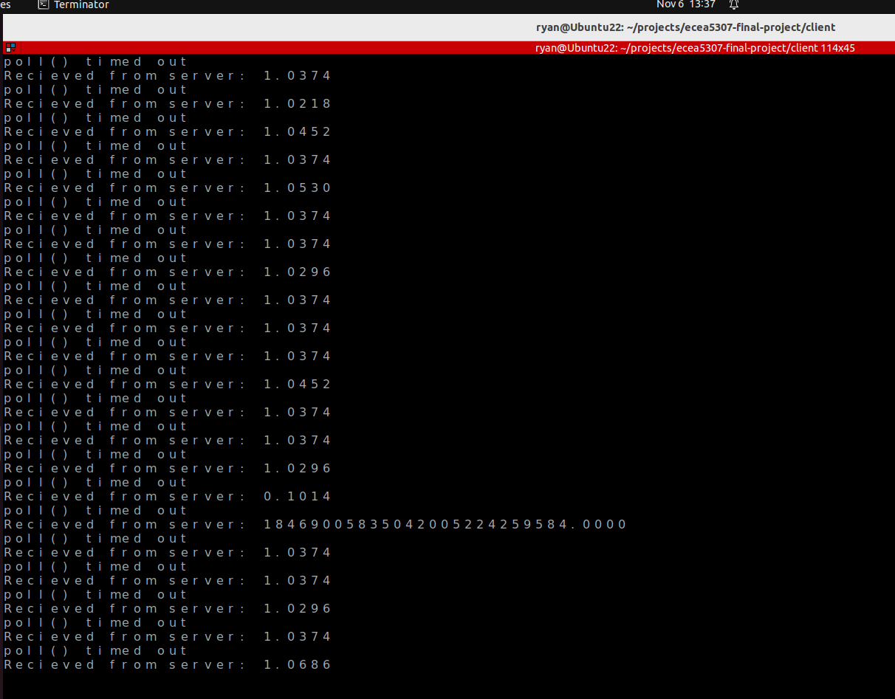
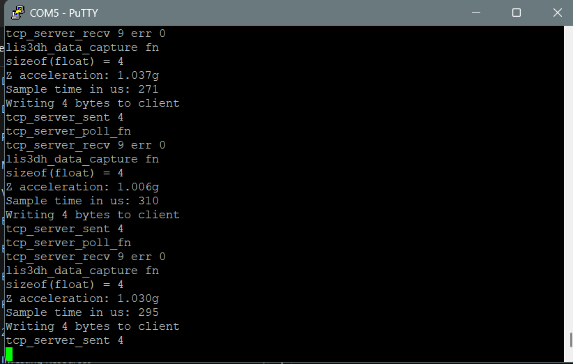

## Activity Log

### 8/21/2026
- cloned git repo to windows
- setup this file
- cloned git repo to Ubuntu VM
- Setup Rasberry Pi 4B (4GB ram)
    - interfaced with the camera module 3 using the built in 'apps' (i.e. `rpicam-hello --timeout 10000`) detailed here: https://www.raspberrypi.com/documentation/computers/camera_software.html
    - installed opencv using quick install method detailed here: https://opencv-opencv.mintlify.app/installation#linux


### 8/21-8/27/2026
- research potential project ideas

### 8/27/2026
## repo setup on VM
Start in `/home/ryan/projects/final-project-ryanchallacombe`
Following the procedure here:
https://github.com/cu-ecen-aeld/buildroot-assignments-base/wiki/Setting-up-Buildroot-for-Hardware-Builds

# Step 1
Run:
```
git remote add buildroot-base https://github.com/cu-ecen-5013/buildroot-assignments-base.git
git fetch buildroot-base
git merge buildroot-base/master # resulted in conflict so did....
git config pull.rebase false
git pull buildroot-base master --allow-unrelated-histories
```
Note: documentataion for the class sometimes uses `buildroot-base` and sometimes `buildroot-assignments-base`. It depends on what we named the remove when we added it (I think). We are using `buildroot-base` as seen below:
```
ryan@Ubuntu22:~/projects/final-project-ryanchallacombe$ git remote -v
buildroot-base  https://github.com/cu-ecen-5013/buildroot-assignments-base.git (fetch)
buildroot-base  https://github.com/cu-ecen-5013/buildroot-assignments-base.git (push)
origin  git@github.com:cu-ecen-aeld/final-project-ryanchallacombe.git (fetch)
origin  git@github.com:cu-ecen-aeld/final-project-ryanchallacombe.git (push)
```
# Step 2
reference: https://github.com/cu-ecen-aeld/buildroot-assignments-base/wiki/Raspberry-Pi-Hardware-Support
```
ryan@Ubuntu22:~/projects/final-project-ryanchallacombe$ git fetch buildroot-base
ryan@Ubuntu22:~/projects/final-project-ryanchallacombe$ git merge buildroot-base/hw-rpi
error: The following untracked working tree files would be overwritten by merge:
    README.md
Please move or remove them before you merge.
Aborting
```
Let's move the README.md file temporarily. 
`git merge buildroot-base/hw-rpi`

Then I did an add / commit / push. 

# Step 3
- Modified the shared.sh file per this link: https://github.com/cu-ecen-aeld/rpi4_buildroot/blob/master/shared.sh
    as instructed at bottom of: https://github.com/cu-ecen-aeld/buildroot-assignments-base/wiki/Setting-up-Buildroot-for-Hardware-Builds
- git add / commit / push
- created a clean.sh based on this reference: https://github.com/cu-ecen-aeld/final-project-tiba6275/blob/master/clean.sh
- ran it, but it did nothing b/c the buildroot dir is empty
- ran build.sh
    appears to have completed successfully.... `onfiguration written to /home/ryan/projects/final-project-ryanchallacombe/buildroot/.config`
- 
# Step 4
before anything, I note that the file here `base_external/configs/aesd_rpi_defconfig` still calls out the rpi3. Note sure when this will be updated.
- Run `make menuconfig` from buildroot dir
    - enable compiler caching
    - created root password
    Take steps to enable wifi as specified here: https://github.com/cu-ecen-aeld/buildroot-assignments-base/wiki/Wifi-Configuration
    - changed the C lib to glibc (was uClibc-ng))
    - -> System Configuration > /dev management > Dynamic using devtmpfs + mdev
    - -> System Configuration > Root filesystem overlay directories > ../base_external/rootfs_overlay 
    - -> Target packages > hardware handling > Firmware > rpi-wifi-firmware or brcmfmac-sdio-firmware-rpi-wifi(under brcmfmac-sdio-firmware-rpi) 
    - -> Target packages -> Networking applications -> wpa_supplicant and select nl80211 support, autoscan, wpa_passphrase binary.
    - -> Target packages -> Networking applications -> dropbear 

- Updated the rootfs overlay dir as specified here: https://github.com/cu-ecen-aeld/buildroot-assignments-base/wiki/Wifi-Configuration
- add wpa_supplicant.conf to the .gitignore file b/c it contains wifi password
- ran `save-config.sh`

This still looks wrong...
```
ryan@Ubuntu22:~/projects/final-project-ryanchallacombe$ cat base_external/configs/aesd_rpi_defconfig
BR2_arm=y
BR2_cortex_a53=y
BR2_ARM_FPU_NEON_VFPV4=y
BR2_PACKAGE_HOST_LINUX_HEADERS_CUSTOM_5_10=y
BR2_TOOLCHAIN_BUILDROOT_CXX=y
BR2_SYSTEM_DHCP="eth0"
BR2_ROOTFS_POST_BUILD_SCRIPT="board/raspberrypi3/post-build.sh"
BR2_ROOTFS_POST_IMAGE_SCRIPT="board/raspberrypi3/post-image.sh"
BR2_LINUX_KERNEL=y
BR2_LINUX_KERNEL_CUSTOM_TARBALL=y
BR2_LINUX_KERNEL_CUSTOM_TARBALL_LOCATION="$(call github,raspberrypi,linux,0b54dbda3cca2beb51e236a25738784e90853b64)/linux-0b54dbda3cca2beb51e236a25738784e90853b64.tar.gz"
BR2_LINUX_KERNEL_DEFCONFIG="bcm2709"
BR2_LINUX_KERNEL_DTS_SUPPORT=y
BR2_LINUX_KERNEL_INTREE_DTS_NAME="bcm2710-rpi-3-b bcm2710-rpi-3-b-plus bcm2710-rpi-cm3"
BR2_LINUX_KERNEL_NEEDS_HOST_OPENSSL=y
BR2_PACKAGE_RPI_FIRMWARE=y
BR2_PACKAGE_RPI_FIRMWARE_BOOTCODE_BIN=y
BR2_PACKAGE_RPI_FIRMWARE_VARIANT_PI=y
BR2_PACKAGE_RPI_FIRMWARE_CONFIG_FILE="board/raspberrypi3/config_3.txt"
BR2_TARGET_ROOTFS_EXT2=y
BR2_TARGET_ROOTFS_EXT2_4=y
BR2_TARGET_ROOTFS_EXT2_SIZE="120M"
# BR2_TARGET_ROOTFS_TAR is not set
BR2_PACKAGE_HOST_DOSFSTOOLS=y
BR2_PACKAGE_HOST_GENIMAGE=y
BR2_PACKAGE_HOST_MTOOLS=y
```
Found the issue. The shared.sh script was causing the save-config.sh script to write to /home/ryan/projects/final-project-ryanchallacombe/base_external/configs/aesd_qemu_deconfig. I updated shared.sh to save to aesd_raspberrypi4_64_defconfig in that directory. 

- Do storage check before building: 
```
ryan@Ubuntu22:~/projects/final-project-ryanchallacombe$ df -h
Filesystem      Size  Used Avail Use% Mounted on
tmpfs           776M  1.8M  774M   1% /run
/dev/sda3        99G   62G   32G  67% /
tmpfs           3.8G  100M  3.7G   3% /dev/shm
tmpfs           5.0M  4.0K  5.0M   1% /run/lock
tmpfs           3.8G     0  3.8G   0% /run/qemu
/dev/sda2       512M  6.1M  506M   2% /boot/efi
tmpfs           776M  164K  775M   1% /run/user/1000
/dev/sr0         51M   51M     0 100% /media/ryan/VBox_GAs_7.2.2
```
After some cleanup:
```
ryan@Ubuntu22:~/projects$ df -h
Filesystem      Size  Used Avail Use% Mounted on
tmpfs           776M  1.8M  774M   1% /run
/dev/sda3        99G   39G   55G  42% /
tmpfs           3.8G   60M  3.8G   2% /dev/shm
tmpfs           5.0M  4.0K  5.0M   1% /run/lock
tmpfs           3.8G     0  3.8G   0% /run/qemu
/dev/sda2       512M  6.1M  506M   2% /boot/efi
tmpfs           776M  164K  775M   1% /run/user/1000
/dev/sr0         51M   51M     0 100% /media/ryan/VBox_GAs_7.2.2
```
- Compared https://github.com/cu-ecen-aeld/final-project-abbottwhitley/blob/master/base_external/configs/aesd_pi4_defconfig with mine. as a result made the following updates:
- reran make menuconfig
    - added python3 with external package socketio package
    - used default core packages
    - added wireless tools

..Phew... I think we are ready for the first build attempt. 
eh... no, let's save the VM state first, then build...

# Step 5
- Build took about 2 hours
- the total `df -h` output for the main disk is `/dev/sda3        99G   49G   45G  52% /`
- The is a file called `sdcard.img` in the location `/home/ryan/projects/final-project-ryanchallacombe/buildroot/output/images`

-- Procedure to get in on the SD card
After spending a lot of time trying to get VBox to mount the sd card, i gave up and decided to do it outside of the VM using Windows. 

I created a shared folder on the VM at: `/media/sf_VBox_shared_folder`

The image can be placed in there. In windows, use the shared folder location: `C:\Users\ryanc\VBox_shared_folder`

Use the Rufus application to write it to the sd card. 

### 8/28/2026
## Testing first image
Boots up to a shell. All in all it looks like good progress. 

Issues: 
- ip addr shows no wlan connection


# debugging
Was able to get it working by 
1. Rerunning the wpa supplicant command as seen below:
    reference: https://wiki.archlinux.org/title/Wpa_supplicant and https://www.baeldung.com/linux/connect-network-cli
2. Manually assigning an ip addr based on knowledge of laptop ip addr using procedure here:
    https://wiki.archlinux.org/title/Network_configuration#IP_addresses

# solution
Found the root issue! The interfaces file in /etc/network was the default one from buildroot b/c the one in the rootfs overlay was named interfaces.txt. The system was dalling the buildroot file, which included no wlan setup. 

So I scp'd the correct file over as below, and it worked!
scp /home/ryan/projects/final-project-ryanchallacombe/base_external/rootfs_overlay/etc/network/interfaces root@192.168.86.100:/etc/network/interfaces2

Restarted the system. Note that it took a couple minutes to boot and obtain it's ip addr. 

TODO:
- add aesd assignments package per a9 to build. Goal is to verify that it will run. 
- add vim or nano 

### 9/3/2026
# RPI4
-Updated `interfaces` file to set a static ip addr for the rpi4 of `address 192.168.86.100`
    It assumes that the network id is `address 192.168.86.1`

# Pico W
- Compiled example program picow_tcp_server.c into picow_tcp_server_poll and picow_tcp_server_background.
- Loaded one (can't remember which) onto the pico w
- Ran the server test with the rpi4 and pico talking to each other. Success!


### 9/5-9/12
# Pico W
- Reviewed LIS3DH datasheet and example code. Investigated various accelerometer settings
- Planned the interface protocol / messaging between the RPI4 and the Pico


### 9/13-9/20
# Pico W
- Implemented LIS3DH to Pico interrupt on shock detection.
- Reviewed in depth the lwip (Light Weight IP) library and example code for a TCP server on the Pico. Ran the examples with my laptop as the client using a python script. 
- Began integration of the Pico TCP server code.
- Setup the structure for a Finite State Machine (FSM) to run on the Pico. 
Issues:
- need to pass float values to the client. This is tricky with python, but should be straightforward with a C application.


### 9/21-9/22
# Pico W
- Continued development and first testing of the FSM using a python client script
Issues:
- Sampled accel values are duplicated. Need to revied settings for sample time vs loop time when captuing data. Likely that we are looping faster than the lis3dh captures data.
- Need to pass timestamps or some type of time references to the client so that data processing can be done.
Resolution:
- added 

# Client
- Developed a first pass at the client script and tested locally using the Ubuntu VM as the client. 


### 10/27/2026
# Pico W
- updated pico_motion_detector (application used for sandboxing) with updated LSI3DH settings. 

### 11/6/2026
- Updated both Client code and FSM
- Initial integration testing with just 1 sampled value sent from the pico
# Client shown below
 
# Server shown below


### 11/7-11/8
- Ton on work on the client. 
- Initial integration testing with the dryer went great!

### 11/9 - 11/11
## Preparing for RPI4 build
- need to add MDN-SYSTEM package to buildroot
- add vim or nano to buildroot

- Updated the files in base_external. ie. config.in, external.desc, external.mk
- ran `make menuconfig` and selected nano and mdn-system packages
- ran `save-config.sh`
- ran:
```
ryan@Ubuntu22:~/projects/final-project-ryanchallacombe$ cat base_external/configs/aesd_raspberrypi4_64_defconfig 
BR2_aarch64=y
BR2_cortex_a72=y
BR2_ARM_FPU_VFPV4=y
BR2_CCACHE=y
BR2_TOOLCHAIN_BUILDROOT_GLIBC=y
BR2_PACKAGE_HOST_LINUX_HEADERS_CUSTOM_5_10=y
BR2_TOOLCHAIN_BUILDROOT_CXX=y
BR2_ROOTFS_DEVICE_CREATION_DYNAMIC_MDEV=y
BR2_TARGET_GENERIC_ROOT_PASSWD="HereGoesNothing"
BR2_SYSTEM_DHCP="eth0"
BR2_ROOTFS_OVERLAY="../base_external/rootfs_overlay"
BR2_ROOTFS_POST_BUILD_SCRIPT="board/raspberrypi4-64/post-build.sh"
BR2_ROOTFS_POST_IMAGE_SCRIPT="board/raspberrypi4-64/post-image.sh"
BR2_LINUX_KERNEL=y
BR2_LINUX_KERNEL_CUSTOM_TARBALL=y
BR2_LINUX_KERNEL_CUSTOM_TARBALL_LOCATION="$(call github,raspberrypi,linux,0b54dbda3cca2beb51e236a25738784e90853b64)/linux-0b54dbda3cca2beb51e236a25738784e90853b64.tar.gz"
BR2_LINUX_KERNEL_DEFCONFIG="bcm2711"
BR2_LINUX_KERNEL_DTS_SUPPORT=y
BR2_LINUX_KERNEL_INTREE_DTS_NAME="broadcom/bcm2711-rpi-4-b"
BR2_LINUX_KERNEL_NEEDS_HOST_OPENSSL=y
BR2_PACKAGE_BRCMFMAC_SDIO_FIRMWARE_RPI=y
BR2_PACKAGE_BRCMFMAC_SDIO_FIRMWARE_RPI_WIFI=y
BR2_PACKAGE_RPI_FIRMWARE=y
BR2_PACKAGE_RPI_FIRMWARE_VARIANT_PI4=y
BR2_PACKAGE_RPI_FIRMWARE_CONFIG_FILE="board/raspberrypi4-64/config_4_64bit.txt"
BR2_PACKAGE_PYTHON3=y
BR2_PACKAGE_PYTHON_SOCKETIO=y
BR2_PACKAGE_DROPBEAR=y
BR2_PACKAGE_WIRELESS_TOOLS=y
BR2_PACKAGE_WPA_SUPPLICANT=y
BR2_PACKAGE_WPA_SUPPLICANT_AUTOSCAN=y
BR2_PACKAGE_WPA_SUPPLICANT_PASSPHRASE=y
BR2_PACKAGE_NANO=y
BR2_TARGET_ROOTFS_EXT2=y
BR2_TARGET_ROOTFS_EXT2_4=y
BR2_TARGET_ROOTFS_EXT2_SIZE="120M"
# BR2_TARGET_ROOTFS_TAR is not set
BR2_PACKAGE_HOST_DOSFSTOOLS=y
BR2_PACKAGE_HOST_GENIMAGE=y
BR2_PACKAGE_HOST_MTOOLS=y
BR2_PACKAGE_MDN_SYSTEM=y
```
- All of the above looks good. 

- Initial build attempts failed to load ased_client onto the image. Failed with and error. 
    It turns out that the aesd_client binary compiled for the VM was tracked by git. 
    So, when Buildroot pulled the code, headers, etc. from the repo it apparently pulled the compiled binary and tried to load that intto the RPI4 image.
    Make failed with 'nothing to do for 'all'' which makes sense now
    Apparently if there is a compiled binary, it doesn't compile it again. 
    I was able to untrack the binary, then the build went smoothly. 

### 11/11/2026 Testing new RPI4 image
- boots up but have to manually start aesd_client b/c i hadn't added the start/stop script to the package .mk file
- had to restart the network. not sure why
    - the S40network file was not executable initially. not sure if this is the cause
- after restarting the network it obtain ip addr 192.168.86.100.
    - is this correct?
- aesd_client ran and looked as expected when running it manually

### 11/12/2026
- added start/stop script to the package .mk file
- went into the rootfs overlay and set the S40network file to be executable.
/home/ryan/projects/final-project-ryanchallacombe/base_external/rootfs_overlay/etc/init.d